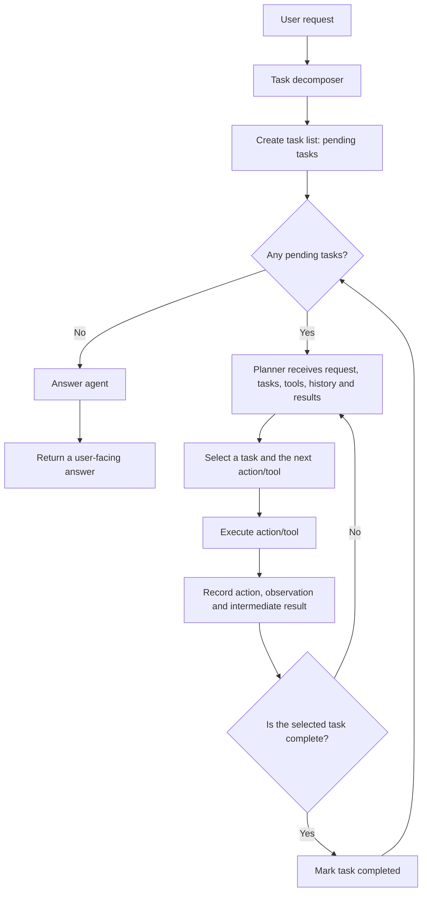

# Advanced agent workflow

This design builds on the basic agent loop by giving the agent an explicit,
trackable task list. A user request is treated as a broader goal; the task
decomposer proposes smaller outcomes, and the planner chooses actions and tools
to make progress toward them.

## Workflow



The planner loop may need several actions to complete one task. An observation
is the result of an individual action; a task should be marked complete only
when its intended outcome has been achieved. The answer agent then turns the
request, completed tasks, action/observation history, and intermediate results
into a clear response.

Tool calls are retried up to three total attempts for transient MCP timeouts and
transport failures, with a short backoff between attempts. Tool results marked
as errors are not replayed automatically; they are recorded as observations so
the planner can use the failure evidence. Observations report the number of
attempts; after the retry limit is exhausted, the planner marks the task failed
instead of requesting another trial of that call.

## Agent state ownership

The LLMs return decisions and proposed task data; they do not mutate
`AgentState` directly. Python validates those responses, executes tool calls,
and applies the resulting state changes.

| `AgentState` field | LLM responsibility | Python responsibility |
| --- | --- | --- |
| `user_input` | Uses the request as context. | Receives the user's request and initializes the state with it. |
| `tasks` | The task decomposer proposes task descriptions. The planner reports a selected task as `completed` or `failed` when warranted by the evidence. | Validates and stores the initial tasks as `pending`; checks planner decisions and applies the reported status. |
| `current_task` | Selects which pending task to work on. | Copies the selected task from the validated planner response into the state. |
| `actions` | Selects the next tool and arguments. | Executes the selected tool call and records its action string. |
| `observations` | Uses prior observations when choosing what to do next. | Records the parsed tool result, or the final execution error after retries. |
| `results` | Provides a reason when it reports a task completed or failed. | Appends tool observations and task-status reasons. Tool observations are currently also stored in `observations`. |
| `current_step` | — | Increments before each planned tool action. Internal retries do not each create a separate step. |
| `max_steps` | — | Sets the step limit when creating the state. |
| `finished`, `final_answer` | The answer agent generates a natural-language response from the completed state. | Stores that response in `final_answer` and marks the run `finished`. |

In short, task completion is an LLM judgment based on the recorded evidence;
Python validates and records that judgment but does not independently verify
the task's outcome.

## Why decompose a request into tasks?

Tasks and actions serve different purposes:

- **A task describes an outcome** that contributes to the user's broader goal.
- **An action describes a concrete next step**, often a tool call, that can help
  achieve an outcome.

For example, “compare two cities' weather” could be decomposed into “get the
weather for city A,” “get the weather for city B,” and “compare the results.”
The planner can choose the specific weather tool calls and decide whether it
needs another action based on the observations it gets back.

An explicit task list can help the agent:

- Keep track of multi-part requests and avoid forgetting a requirement.
- Make progress visible and distinguish unfinished work from completed work.
- Re-plan a task when a tool result is missing, unexpected, or insufficient.
- Check whether it has enough information before composing the final answer.

The task decomposer is not valuable merely because it turns a request into
English sentences. Its value is in producing useful, checkable outcomes that
guide planning and provide a way to track progress. If tasks are vague,
duplicated, or not checked against results, decomposition adds overhead without
improving the agent. A simple request may not need a separate decomposition
step at all; the planner can handle it directly.

Tasks are a plan, not an immutable script. The planner should be able to revise
or split a task when observations show that the original plan is insufficient.

## Updating a task dictionary

If `agent_state.tasks` contains dictionaries, iterating over it gives you
references to the dictionary objects stored in the list. For example:

```python
for task in agent_state.tasks:
    if task["task"] == current_task:
        task["state"] = "completed"
```

This changes the dictionary in the list directly; deleting it and appending a
replacement is not necessary. More precisely, Python passes object references
by assignment. The loop variable `task` and the list element refer to the same
mutable dictionary object, so changing one of its values is visible through
the list. Reassigning `task` itself, such as `task = { ... }`, would only bind
the local variable to a different object and would not replace the list item.
